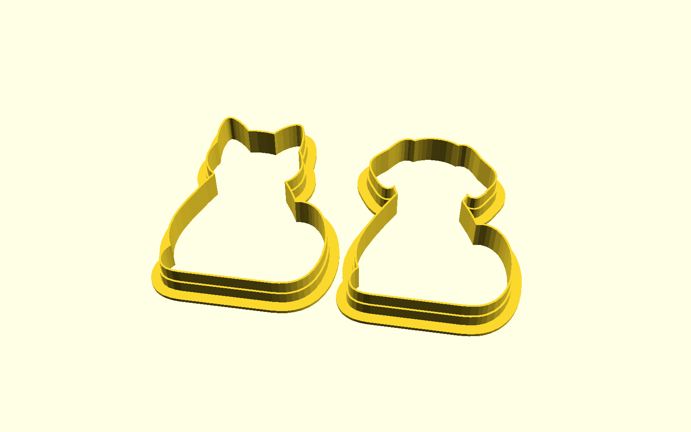
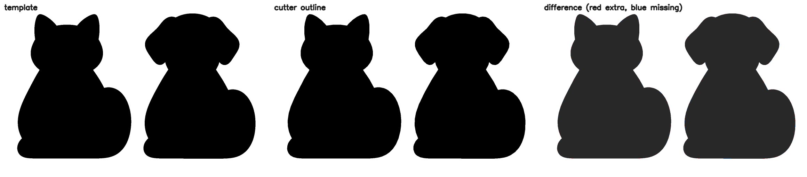

# Cookie cutters

Cat and dog cookie cutters for a [Bambu Lab H2D](https://bambulab.com/en/h2d/tech-specs). The inner cutting outline follows [`references/template.png`](references/template.png). The file to print is [`models/cat_dog_cookie_cutters.3mf`](models/cat_dog_cookie_cutters.3mf).



Open [`scad/cat_dog_cookie_cutters.scad`](scad/cat_dog_cookie_cutters.scad) in OpenSCAD to inspect the solid. Units are millimetres.

## Shape

The cat is on the left and the dog is on the right. Each animal is its own cutter, so the cookie comes out the size of that silhouette.



The difference panel is the shared silhouette. Red would be outline that is not in the template, and blue would be template that the outline missed.

| Cutter | Match (IoU) | Cookie size |
| --- | ---: | --- |
| Cat | 0.9989 | 62.4 × 79.4 mm |
| Dog | 0.9987 | 61.2 × 79.9 mm |

The taller silhouette is scaled to 80 mm, which is a normal size for a rolled cookie. Simplifying the pixel outline shortens that side by a fraction of a millimetre. The pair fits on the H2D bed with room to spare: about 147 × 91 mm, and 14 mm tall.

The drawing leaves 7.5 mm between the animals. Each rim extends 5.6 mm past the cookie, so the printed pair is moved 2.85 mm farther apart on each side. The flanges stay 2 mm clear of each other.

## Wall

The profile is the usual one for a 0.4 mm nozzle and dough rolled to about 4–7 mm. Heights are multiples of a 0.2 mm layer. Thicknesses are whole nozzle lines. The inner face is the drawing, so the cookie matches the silhouette and the extra plastic is on the outside.

| Feature | Size | Role |
| --- | --- | --- |
| Cutting edge | 0.8 mm, full 14 mm height | Two extrusion lines. Thin enough to cut, thick enough to stay in one piece. |
| Lower wall | 1.6 mm up to 7.6 mm | Stiffens the tall sides. |
| Rim | 4 mm wide, 1.6 mm thick | Palm surface, and the part that sits on the bed. |

Background on this cross-section: [How to Design a 3D Printed Cookie Cutter](https://lyramaker.com/guides/cookie-cutter-design/).

## Printing on an H2D

Import the 3MF into Bambu Studio and choose the H2D with the included 0.4 mm nozzle. The file is the solid. The slicer adds the printer profile.

- Orientation: flange on the plate, cutting edge up. No supports.
- Layer height: 0.2 mm.
- Wall generator: Arachne, so the 0.8 mm edge is two lines and the 1.6 mm wall is four.
- Walls: 4. Thinner regions only receive as many lines as fit.
- Top and bottom shells: 4 layers, so the 1.6 mm rim is solid.
- Infill: 15%. Almost none of the part has an interior.
- Outer wall: about 40 mm/s if the blade looks rough at the default speed.
- Elephant-foot compensation: about 0.15 mm, so the first layer does not creep into the opening.
- Brim: leave it off unless the rim lifts. The rim is already a wide first layer.

PLA is the usual material for a cookie cutter. Wash the cutter before it touches dough. Keep it for food if the nozzle has been printing other filaments.

If you want one animal on its own, use Split to Objects in Bambu Studio. The file contains two separate shells.

## Development

```bash
sudo apt install openscad python3-numpy python3-opencv python3-pytest
make test
make generate
```

`make test` checks the outline against the template, the wall dimensions, and the mesh OpenSCAD writes. The match gate is an intersection-over-union of 0.995 for each animal. `make generate` rewrites the OpenSCAD outlines, the pictures, and the 3MF.

See [CONTRIBUTING.md](CONTRIBUTING.md) and [PROJECT_STATUS.md](PROJECT_STATUS.md).

## Layout

| Path | Contents |
| --- | --- |
| `references/template.png` | Source artwork |
| `src/cookie_cutter/` | Outline tracing, wall profile, 3MF checks |
| `scad/cutter_profile.scad` | Wall cross-section |
| `scad/cat_dog_cookie_cutters.scad` | Model to open in OpenSCAD |
| `models/` | 3MF, render, and the outline comparison |
| `tests/` | Unit tests and the OpenSCAD export test |
| `.cursor/rules/` | Project rules for Cursor |

## License

[MIT](LICENSE)
